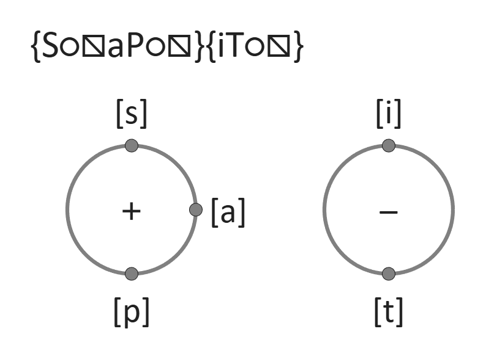
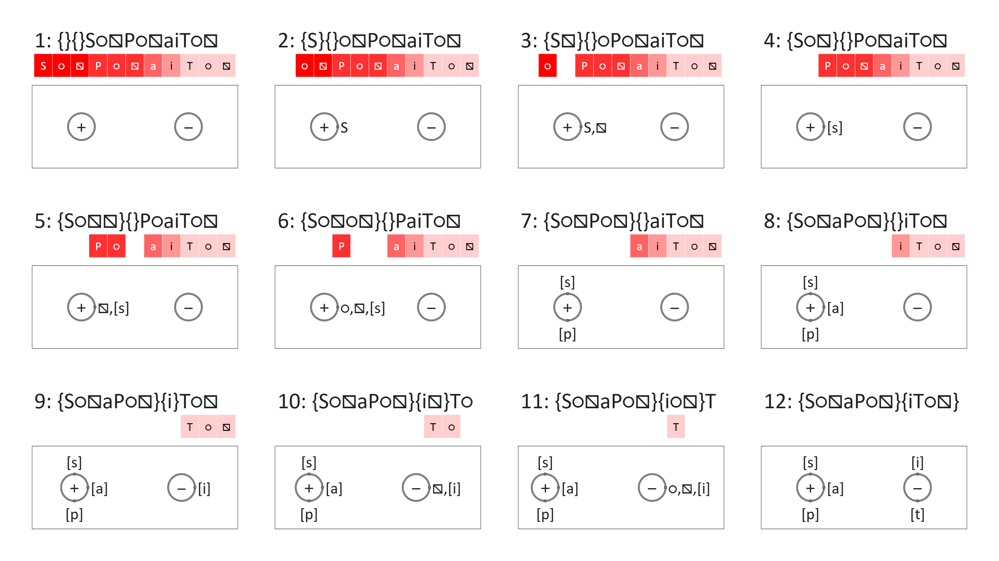
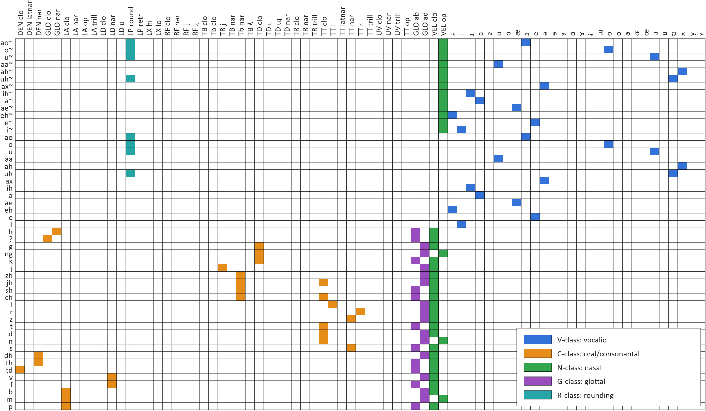
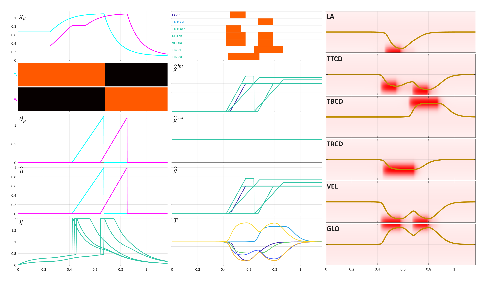

# Mode Coupling

Supplementary material for "A mode-coupling theory of phonological organization" (Tilsen, 2026).

This repository contains a MATLAB implementation of the model described in the manuscript, the data it runs on, and code to produce the figures in this document.

## Contents

| directory | what's in it |
| --- | --- |
| [`model/`](model) | mode-coupling, mode-selection, and vocal tract control models |
| [`plotting/`](plotting) | one plot class per model class (`<modelClass>Plot`) |
| [`data/`](data) | phone, gesture, tract-system and phonotactic inventories, the target configurations, and the default energy weights (CSV) |
| [`experiments/`](experiments) | configuration generation and evaluation, with the energy-weight sweeps in [`experiments/weights/`](experiments/weights) |
| [`tools/`](tools) | [`makeFigures.m`](tools/makeFigures.m), which renders every figure below |
| [`external/`](external) | utility code |

## Quick start

Add the repository and its subdirectories to the MATLAB path, then build a configuration:

```matlab
addpath(genpath('.'));

mc = modeConfig("s p a ~i t");     % a phone sequence
gm = gmConfigurator(mc);
gm = gm.genModeConfig();           % relax it to a final configuration

disp(gm.FinalConfig.ToString());
```

```
{S○⧅aP○⧅}{iT○⧅}
```

## Mode configurations

A configuration assigns each activated gestural excitation to a coordination mode and a phase within that mode, or leaves the excitation uncoupled. `plotFinal` draws the configuration that the configurator settled on:

```matlab
gm.plotFinal();
```



Each circle is a coordination mode, and the `+`/`−` inside each circle is the mode's sign. Points on its circumference are gestural excitations. `plotIters` shows how the configuration got there, one relaxation step per panel:

```matlab
gm.plotIters();
```



Note that uncoupled excitations are shown at the top of each panel, shaded by their activation.

## Articulae

The `articulae` class loads the phone, gesture, and phonotactic inventories and provides helper functions over them.

```matlab
A = articulae('English');
```

The gesturals of the model are defined in [`data/gestures.csv`](data/gestures.csv) — one table carrying both the phonological inventory and, for the gesturals that have them, task-dynamic parameters (tract system, target, stiffness). Phones are in [`data/phones.csv`](data/phones.csv), and a phone-to-gesture mapping is in [`data/phoneGestureMap.csv`](data/phoneGestureMap.csv):

```matlab
A.plotPhoneGestureMap();
```

[](figs/phone-gesture-map.png)

Only English phones are shown above. Rows are phones, columns are gesturals, and cell colors indicate classes.

A phone sequence is converted to sets of gestural excitations:

```matlab
cellfun(@(c)disp(strjoin(c,', ')),A.phonesToGests("p ih t"))
```

```
LA clo, GLO ab, VEL clo
ɪ
TT clo, GLO ab, VEL clo
```

Each excitation receives an activation value as follows. A phone sequence of $`n_p`$ phones is converted by giving the excitations of the $`p`$-th phone the activation $`1-\tfrac{p-1}{n_p}`$, so activation decreases through the sequence. Each phone contributes one excitation of each of its gesturals, so a gestural used by several phones has several excitations. The one exception to the activation rule is affricates, whose narrowing gestural gets an activation halfway to the next phone's, below its closure. `modeConfig.phoneSeqToExcitation` returns the same activations as a gesturals × excitations array. This *ad hoc* approach is adopted merely for convenience: in theory there are no phone units and gestural-activation values are learned in association with external systems (conceptals) that correspond to meanings.

Phones for specifying gestural activation are written with the ASCII tokens in the `Name` column of `phones.csv` where one exists — `ih` for `ɪ` above. The full list is under the table below.

### Gestural symbols

The gesturals currently available, with the symbols used to label them in configuration plots. English phones associated with each gestural are shown for reference:

| gesture | symbol | class | type | English phones |
| --- | --- | --- | --- | --- |
| `ɛ` | ɛ | vocalic | i-type | ɛ ɛ̃ |
| `i` | i | vocalic | i-type | i ĩ |
| `ɪ` | ɪ | vocalic | i-type | ɪ ɪ̃ |
| `a` | a | vocalic | i-type | a ã |
| `ɐ` | ɐ | vocalic | i-type | — |
| `ɑ` | ɑ | vocalic | i-type | ɑ ɑ̃ |
| `ɒ` | ɒ | vocalic | i-type | — |
| `æ` | æ | vocalic | i-type | æ æ̃ |
| `ɔ` | ɔ | vocalic | i-type | ɔ ɔ̃ |
| `e` | e | vocalic | i-type | e ẽ |
| `ə` | ə | vocalic | i-type | ə ə̃ |
| `ɘ` | ɘ | vocalic | i-type | — |
| `ɜ` | ɜ | vocalic | i-type | — |
| `ɞ` | ɞ | vocalic | i-type | — |
| `ɤ` | ɤ | vocalic | i-type | — |
| `ɨ` | ɨ | vocalic | i-type | — |
| `ɯ` | ɯ | vocalic | i-type | — |
| `o` | o | vocalic | i-type | o õ |
| `ɵ` | ɵ | vocalic | i-type | — |
| `ø` | ø | vocalic | i-type | — |
| `ɶ` | ɶ | vocalic | i-type | — |
| `œ` | œ | vocalic | i-type | — |
| `u` | u | vocalic | i-type | u ũ |
| `ʉ` | ʉ | vocalic | i-type | — |
| `ʊ` | ʊ | vocalic | i-type | ʊ ʊ̃ |
| `ʌ` | ʌ | vocalic | i-type | ʌ ʌ̃ |
| `y` | y | vocalic | i-type | — |
| `ʏ` | ʏ | vocalic | i-type | — |
| `DEN clo` | T̪ | oral/consonantal | i-type | t̪ |
| `DEN latnar` | Ɬ̪ | oral/consonantal | i-type | — |
| `DEN nar` | S̪ | oral/consonantal | i-type | θ ð |
| `GLO clo` | ʔ | oral/consonantal | i-type | ʔ |
| `GLO nar` | H | oral/consonantal | i-type | h |
| `LA clo` | P | oral/consonantal | i-type | p m b |
| `LA nar` | ɸ | oral/consonantal | i-type | — |
| `LA op` | — | oral/consonantal | i-type | — |
| `LA trill` | ʙ | oral/consonantal | i-type | — |
| `LD clo` | P̪ | oral/consonantal | i-type | — |
| `LD nar` | F | oral/consonantal | i-type | f v |
| `LD ʋ` | Ʋ | oral/consonantal | i-type | — |
| `RF clo` | Ʈ | oral/consonantal | i-type | — |
| `RF nar` | S̢ | oral/consonantal | i-type | — |
| `RF ɭ` | ɭ | oral/consonantal | i-type | — |
| `RF ɻ` | ɻ | oral/consonantal | i-type | — |
| `TB clo` | K̡ | oral/consonantal | i-type | — |
| `Tb clo` | C | oral/consonantal | i-type | — |
| `TB j` | J | oral/consonantal | i-type | j |
| `TB nar` | X̡ | oral/consonantal | i-type | — |
| `Tb nar` | Ʃ | oral/consonantal | i-type | t͡ʃ ʃ d͡ʒ ʒ |
| `TB ʎ` | ʎ | oral/consonantal | i-type | — |
| `TD clo` | K | oral/consonantal | i-type | k ŋ g |
| `TD ʟ` | ʟ | oral/consonantal | i-type | — |
| `TD ɰ` | ɰ | oral/consonantal | i-type | — |
| `TD nar` | X | oral/consonantal | i-type | — |
| `TR clo` | ʡ | oral/consonantal | i-type | — |
| `TR nar` | Ħ | oral/consonantal | i-type | — |
| `TR trill` | ʜ | oral/consonantal | i-type | — |
| `TT clo` | T | oral/consonantal | i-type | n d t t͡ʃ d͡ʒ |
| `TT l` | L | oral/consonantal | i-type | l |
| `TT latnar` | Ɬ | oral/consonantal | i-type | — |
| `TT nar` | S | oral/consonantal | i-type | s z |
| `TT r` | ɹ | oral/consonantal | i-type | ɹ |
| `TT trill` | R | oral/consonantal | i-type | — |
| `UV clo` | Q | oral/consonantal | i-type | — |
| `UV nar` | Χ | oral/consonantal | i-type | — |
| `UV trill` | Ʀ | oral/consonantal | i-type | — |
| `TT op` | — | oral/consonantal | i-type | — |
| `VEL clo` | ⧅ | nasal | d-type | p b f v t̪ θ ð s d t z ɹ l t͡ʃ ʃ d͡ʒ ʒ j k g ʔ h |
| `VEL op` | □ | nasal | d-type | m n ŋ ĩ ẽ ɛ̃ æ̃ ã ɪ̃ ə̃ ʊ̃ ʌ̃ ɑ̃ ũ õ ɔ̃ |
| `GLO ab` | ○ | glottal | d-type | p f t̪ θ s t t͡ʃ ʃ k ʔ h |
| `GLO ad` | ⦶ | glottal | d-type | m b v ð n d z ɹ l d͡ʒ ʒ j ŋ g |
| `LX hi` | ↑ | laryngeal | d-type | — |
| `LX lo` | ↓ | laryngeal | d-type | — |
| `LP round` | ← | rounding | d-type | ʊ u o ɔ ʊ̃ ũ õ ɔ̃ |
| `LP retr` | → | rounding | d-type | — |

In configuration plots, when an oral gestural, a velum gestural, and a glottal gestural are all coupled to the same mode at the same phase, the three are collapsed into the corresponding IPA consonant in square brackets. For example, `P` + `○` + `⧅` is drawn as `[p]`.

**Input tokens.** [`data/phoneGestureMap.csv`](data/phoneGestureMap.csv) is keyed on the `Name` column of [`data/phones.csv`](data/phones.csv): an ASCII token for every English phone whose IPA symbol is not plain ASCII, and for some other phones; a phone without a token is keyed, and typed, by its IPA symbol. For English most of these tokens are lowercase [ARPABET](https://en.wikipedia.org/wiki/ARPABET) where ARPABET has a symbol. Eighteen English phones have a token:

| token | `aa` | `ae` | `ah` | `ao` | `ax` | `ch` | `dh` | `eh` | `ih` |
| --- | --- | --- | --- | --- | --- | --- | --- | --- | --- |
| phone | ɑ | æ | ʌ | ɔ | ə | t͡ʃ | ð | ɛ | ɪ |

| token | `jh` | `ng` | `r` | `sh` | `th` | `uh` | `zh` | `?` | `td` |
| --- | --- | --- | --- | --- | --- | --- | --- | --- | --- |
| phone | d͡ʒ | ŋ | ɹ | ʃ | θ | ʊ | ʒ | ʔ | t̪ |

ARPABET's `Q` for the glottal stop is already the IPA symbol of the uvular plosive, so `?` stands in for it. ARPABET has no dental stop, so `td` ("t, dental") stands in for `t̪`. Nasalized counterparts append `~` to the token (`ih~`, `eh~`, `ae~`, `ax~`, …), an ASCII stand-in for the combining tilde of the phone's IPA symbol, and a nasalized vowel can also be typed as its symbol, written as the vowel followed by U+0303 (`ɛ̃`); a precomposed character such as `ã` matches too. The remaining English phones have ASCII symbols and are typed as themselves: `p b t d k g f v s z l m n h j i e a o u`.

Some non-English phones also carry a token:

| | tokens |
| --- | --- |
| vowels | `eu` ø, `oe` œ, `yh` ʏ, `uu` ɯ, `oo` ɤ, and their nasalized counterparts (`eu~`, …) |
| ejectives — base + `'` | `p'` pʼ, `t'` tʼ, `k'` kʼ, `s'` sʼ |
| implosives — base + `` ` `` | `` b` `` ɓ, `` d` `` ɗ, `` j` `` ʄ, `` g` `` ɠ, `` G` `` ʛ |
| labialized stops — base + `w` | `pw` pʷ, `bw` bʷ, `tw` tʷ, `dw` dʷ, `kw` kʷ, `gw` gʷ |
| other | `ts` t͡s, `dz` d͡z, `tr` r (alveolar trill) |

Either form is accepted — a token is matched against `Name` first and then against the IPA `Symb`, so `p ih t` and `p ɪ t` are the same input. Where the two collide `Name` wins: `r` is the token for `ɹ`, so the alveolar trill is typed `tr`.

**Markers.** A token can carry markers:

| marker | example | effect |
| --- | --- | --- |
| leading `~` | `~i` | the phone's vocalic gestural has negative sign (non-nucleic), so it prefers a $`\{-\}`$ mode and is penalized in a $`\{+\}`$ mode (the `nucleic` term); `s p a ~i t` uses it for the second half of the diphthong |
| trailing `+` | `a+` | length: adds a non-nucleic copy of the phone after it, so `a+` is `a ~a` |
| trailing `^` | `a^` | accentuation: one unit per `^`, on the phone's vocalic gestural only (see [Metrical activation](#metrical-activation)) |

A trailing `~` is not a marker but part of a nasalized vowel's token (`ae~`). Markers on a phone with no vocalic gestural have no effect, except that `+` still adds a copy.

The table lists every gestural in `gestures.csv`, in class order, with symbols and classes from that file. The English-phones column is derived from `phoneGestureMap.csv` restricted to the phones flagged `English` in `phones.csv`; `—` marks a gestural no English phone uses (or, in the symbol column, one without a label symbol). Regenerate the table if any of the three files changes.

## Configuration energy

`gmConfigurator` scores every configuration reachable from the current one in a single change, using [`configEnergies`](model/configEnergies.m), and then moves to one of them. A change either couples one uncoupled excitation to any mode, or demotes one orbit — all excitations coupled to the same mode with the same phase — to the next mode in the order $`\mu_1^+,\mu_1^-,\mu_2^+,\ldots`$; the current configuration is itself a candidate. Total energy is a weighted sum of one unbound term and seven bound terms. The weights are loaded from [`data/defaultWeights.csv`](data/defaultWeights.csv), and are listed below in the order the energy arrays are drawn (decreasing weight):

| term (CSV) | symbol | default | penalizes |
| --- | --- | --- | --- |
| `unbound` | $`w_{\mathrm{unb}}`$ | 90 | each excitation not yet coupled to a mode, in proportion to its activation |
| `dependency` | $`w_{\mathrm{dep}}`$ | 23 | a d-type excitation in an orbit that holds no i-type excitation |
| `adaptation` | $`w_{\mathrm{adapt}}`$ | 23 | a coupled excitation whose activation falls below the effective vocalic floor for its mode (a {-} mode takes the floor of the next {+} mode) |
| `exclusion` | $`w_{\mathrm{excl}}`$ | 12 | two excitations sharing a $`q`$-state, except on the zero-phase orbit of a {+} mode |
| `nucleic` | $`w_{\mathrm{nuc}}`$ | 3 | a {+} mode without exactly one non-negative vocalic excitation, and each negative one |
| `phonotactics` | $`w_{\mathrm{phon}}`$ | 1.6 | a prohibited ordered pair from [`data/phonotacticsEnglish.csv`](data/phonotacticsEnglish.csv) |
| `bound` | $`w_{\mathrm{bind}}`$ | 1 | each coupled i-type excitation, scaled by its mode's cost $`\epsilon_m`$ |
| `phasebias` | $`w_{\mathrm{phase}}`$ | 0.06 | a consonantal or d-type excitation coupled to a {-} mode |

Classification follows the `Class` column of [`data/gestures.csv`](data/gestures.csv): i-type (independent) excitations are the `V` and `C` classes, d-type (dependent) excitations the `N` class (velum), `G` class (glottal abduction/adduction), `L` class (laryngeal elevation), and `R` class (lip rounding). Note that `GLO clo` (for [ʔ]) and `GLO nar` (for [h]) are `C`-class. A $`q`$-state is the tuple of an excitation's mode, relative phase, and class. The mode cost that scales the `bound` term,

```math
\epsilon_m = \ell(m) + c_-[s_m<0] - c_{\mathrm{metr}}\bar{\sigma}_{\ell(m)},
```

grows with mode level $`\ell(m)`$, adds $`c_-=\tfrac{2}{3}`$ for a {-} mode (`antiphaseCost`), and is reduced by $`c_{\mathrm{metr}}=\tfrac{1}{2}`$ (`metricalEnergyWeight`) times the metrical activation $`\bar{\sigma}_{\ell(m)}`$ computed below, so excitation coupling to modes of metrically active syllables is less costly.

Weights and the remaining configurator parameters are read and written together:

```matlab
gm = gmConfigurator(mc);
disp(gm.getParams());                        % weights, then Beta, StabCrit, MaxIters, Method, Metricalizer
gm = gm.setParams("[exclusion 20][Beta 2]"); % any weight or parameter, by name
```

`gmConfigurator.editDefaultWeights("exclusion",20)` rewrites the CSV (any number of name/value pairs), changing the defaults for every configurator built afterwards.

### Fitting the weights

The default weights were fitted against the targets in [`data/configs.csv`](data/configs.csv) with the scripts in [`experiments/weights/`](experiments/weights). Because total energy is linear in the weights and the Boltzmann step divides by their L1 norm, only weight *ratios* matter, so one term (`bound`) is held at 1.

| script | role |
| --- | --- |
| `exploreWeights` | samples weight vectors and scores each by the proportion of configurations that match their target |
| `scoreWeights` | scores a single weight vector; used for ablation (zeroing one term at a time) |
| `reduceWeights` | starting from a working vector, shrinks the spread of ratios, centers each term in the interval where accuracy holds, and rounds to quotable values |
| `analyzeWeights` | runs the full pipeline: β check, baseline, ablation, sweep, and which pairwise weight orderings are necessary |
| `weightCone` | for a given run, the exact set of weight vectors that reproduce it, as linear inequalities |

Each script's header documents its options.

### Temperature

At each iteration the next configuration is drawn from a Boltzmann distribution over the accessible set $`\mathcal{A}`$:

```math
p\left(x^{(n)}\to x^{(n+1)}\right) = \frac{e^{-\beta\Delta\tilde{E}}}{Z_n},
\qquad
\Delta\tilde{E} = \frac{E(x^{(n+1)}) - E(x^{(n)})}{\sum_t w_t},
\qquad
Z_n = \sum_{y\in\mathcal{A}} e^{-\beta\Delta\tilde{E}(y)}
```

Note that the energy difference is divided by the L1 norm of the weight vector before exponentiating, so $`\beta`$ is expressed per unit of *weight-normalized* energy and its values stay comparable when the weights are rescaled.

| parameter | symbol | default | meaning |
| --- | --- | --- | --- |
| `Beta` | $`\beta`$ | 1e6 | inverse temperature; the default is effectively the $`\beta\to\infty`$ (deterministic) limit |
| `Method` | | `"bonding_stochastic"` | selection rule (see below) |
| `MaxIters` | | 100 | maximum coupling iterations |
| `StabCrit` | | 5 | consecutive iterations without a change before the configuration is called stable |
| `Metricalizer` | | `"English"` | `gmMetricalizer` preset |

`"bonding_stochastic"` samples from the distribution above. `"ideal_relaxation"` is deterministic: it moves to the lowest-energy alternative, and only when that is lower than the current configuration.
```matlab
gm = gm.genModeConfig(beta=2);   % raise the temperature for this run only
disp(gm.LastRun.Beta);           % 2: the settings the last run used
```

Options passed to `genModeConfig` (`Method`, `beta`, `StabCrit`) apply to that run only and leave the configurator's own properties unchanged; `LastRun` records what the run actually used.

Lowering $`\beta`$ makes non-standard configurations more likely; [`experiments/mcExperiment.m`](experiments/mcExperiment.m) sweeps it and collects final-configuration frequencies.

## Testing

Generate configurations for the inputs in [`data/configs.csv`](data/configs.csv) and compare them against the targets specified there:

```matlab
evalConfigs(overwrite=true);
```

```
100.0 (47/47) configurations matched target.
```

Unit checks for the data tables, input markers and candidate generation are in [`model/tests/`](model/tests); run them all with:

```matlab
runAllTests
```

`validateData()` on its own lists every inconsistency between the CSV tables, including warnings (for example, gesturals no phone uses).

## Relative phase dynamics

[`relativePhaseDynamics`](model/relativePhaseDynamics.m) simulates each coordination mode together with its coupled excitations as a separate oscillator network. It is a stand-alone solver: configuration relaxation does not run it. Instead `modeConfig` assigns each coupled excitation a precomputed phase that reproduces the solver's steady-state ordering (all vowels at zero phase in a $`\{+\}`$ mode, evenly spaced phases among the C-class excitations of a $`\{+\}`$ mode or the i-type excitations of a $`\{-\}`$ mode, and d-type excitations matching the phase of an i-type excitation with the same activation), and recomputes them for every candidate configuration. Let $`\mathcal{O}_m`$ contain the excitations and the mode oscillator itself. For network members $`u,v`$, the dynamics and implemented forward-Euler update are

```math
\begin{aligned}
\dot{\theta}_u &= \omega-\kappa\sum_{v\in\mathcal{O}_m}\Phi_{uv}\sin(\theta_u-\theta_v),\\
\theta_u(t+\Delta t) &= \theta_u(t)+\Delta t\,\dot{\theta}_u(t).
\end{aligned}
```

The common natural angular frequency $`\omega`$ (`omega`) defaults to $`40\pi`$ radians per unit time, the coupling-rate scale $`\kappa`$ (`a`) to 10, the timestep $`\Delta t`$ (`dt`) to $`10^{-3}`$, and `tspan` to `[0 5]`. The entry $`\Phi_{uv}`$ gives the influence of oscillator $`v`$ on oscillator $`u`$: positive entries attract phases toward equality, negative entries repel them toward a difference of $`\pi`$ modulo $`2\pi`$. Diagonal entries are zero.

In the excitation-to-excitation block $`K`$ of $`\Phi`$, positive modes have coupling $`-1`$ between distinct C-class excitations; negative modes have coupling $`-1`$ between distinct i-type excitations. For either mode sign, an i-type excitation influences a d-type excitation with coupling $`+1`$ when their activations are equal, without reciprocal influence. All other excitation-block entries are zero. The solver's i-type test is the excitation's `Type` field (1 when its `Class` is `V` or `C`), the same classification used by `configEnergies`.

The mode entries are $`\Phi_{j\mu_m}=\Phi_{\mu_m j}=\mathcal{I}_j`$, where $`\mathcal{I}_j`$ indicates i-type. The mode is therefore influenced reciprocally by i-type excitations, and has no direct coupling to d-type excitations. With $`\varphi_j=\theta_j-\theta_m^\mu`$, the mode contribution to the excitation velocity is $`-\kappa\,\mathcal{I}_j\sin\varphi_j`$. The common natural frequency cancels in relative-phase dynamics. Note that this solver does not implement inter-mode coupling or level-dependent natural frequencies.

## Metrical activation

[`gmMetricalizer`](model/gmMetricalizer.m) assigns metrical activation to each syllable system, where syllable systems correspond to positive/negative mode pairs. Let $`\sigma_\ell^{(k)}`$ be the raw activation of syllable system $`\ell`$ at iteration $`k`$. Its input combines internal, accentual, and boundary contributions:

```math
I_\ell = \eta_\ell^+\left(w_{\mathrm{int}}\eta_\ell^-
 + w_{\mathrm{acc}}a_\ell^{\mathcal{L}}
 + w_{\mathrm{beg}}b_\ell^{\mathrm{beg}}
 + w_{\mathrm{end}}b_\ell^{\mathrm{end}}\right),
\qquad \sigma_\ell^{(1)} = I_\ell .
```

The occupation indicators $`\eta_\ell^+`$ and $`\eta_\ell^-`$ are 1 when the corresponding mode contains systems and 0 otherwise. The accentual input $`a_\ell^{\mathcal{L}}`$ sums the `Accentuation` values of the nucleic (non-negative-sign) vocalic excitations across both modes. A `^` on an input phone (`a^`) accents only that phone's vocalic gestural. The default weights are `internalWeight`: $`w_{\mathrm{int}}=\tfrac{2}{3}`$, `accentualWeight`: $`w_{\mathrm{acc}}=2`$, `beginWeight`: $`w_{\mathrm{beg}}=1`$, and `endWeight`: $`w_{\mathrm{end}}=1`$. Positive-mode occupation gates the combined input.

Boundary inputs $`b_\ell^{\mathrm{beg}}`$ and $`b_\ell^{\mathrm{end}}`$ are `beginInput` for the highest level $`\sigma`$-system, `endInput` for the lowest, and zero elsewhere. Both parameters default to zero, but the `English` preset selected by `gmConfigurator` sets `endInput` to $`-1`$.

Activations update simultaneously from the preceding iteration:

```math
\sigma_\ell^{(k+1)} = \sigma_\ell^{(k)}
 + \alpha\tanh\!\left(-\sigma_{\ell-1}^{(k)}-\sigma_{\ell+1}^{(k)}\right)
 + \lambda\left(I_\ell-\sigma_\ell^{(k)}\right)
 - \gamma \sigma_\ell^{(k)} .
```

Here $`\alpha`$ (`alpha`) sets the strength of the neighboring-level interactions, $`\lambda`$ (`beta`) sets attraction toward the input, and $`\gamma`$ (`gamma`) sets linear decay; their defaults are $`\alpha=\tfrac{2}{3}`$, $`\lambda=1`$, and $`\gamma=\tfrac{1}{10}`$. The implementation uses this discrete update with no separate timestep parameter. It stops when every activation changes by less than `stabTol` (default $`10^{-4}`$), or reaches `maxIters` (default 100 stored states, counting the initialization $`\sigma_\ell^{(1)}`$).

After iteration, negative values are floored at zero and the activations are normalized by the largest positive value:

```math
\bar{\sigma}_\ell =
\begin{cases}
\displaystyle\frac{\max\left(0,\sigma_\ell^{(k^{*})}\right)}
{\max_{\ell'} \sigma_{\ell'}^{(k^{*})}},
& \max_{\ell'} \sigma_{\ell'}^{(k^{*})} > 0, \\
0, & \text{otherwise}.
\end{cases}
```

The normalized activation is stored as the syllable's `metricalAct` and assigned to both modes in its pair.

## Mode-selection dynamics

`modeSelection` implements the competitive-selection mechanism that selects and suppresses $`\mu`$-systems. Its state variables are:

| symbol | meaning |
| --- | --- |
| $`x_\mu`$ | mode activation |
| $`\Xi_\mu`$ | mode rank (order of activation, 1 = most active) |
| $`\theta_\mu`$ | mode oscillator phase clock |
| $`\hat{\mu}`$ | mode feedback (fraction of the way to suppression) |
| $`g`$ | gestural excitation |
| $`G`$ | gated gestural activation |
| $`\hat{g}`$ | gestural feedback, $`\hat{g}^{int}+\hat{g}^{ext}`$ (only $`\hat{g}^{int}`$ is driven) |
| $`F`$ | tract-system force field |
| $`T`$ | tract-variable state (position, velocity) |

### Mode activation

Only modes with coupled excitations have non-zero activation. Their activations start evenly spaced between 1 and 0, in the order of the configuration's modes, and each grows logistically toward a maximum activation $`\kappa`$ (`modeCapacity`, 1.1):

```math
\dot{x}_\mu =
\begin{cases}
g_M\,x_\mu(\kappa - x_\mu) & \mu\ \text{selected, or growing},\\
\gamma_d\,(x_{\mathrm{floor}} - x_\mu) & \mu\ \text{suppressed},\\
0 & \text{otherwise}.
\end{cases}
```

A mode is *selected* the first time $`x_\mu`$ reaches the selection threshold (`selectionThreshold`, 1), and stays selected until it is suppressed (below). A mode that is neither selected nor suppressed is *growing* unless its growth is gated off. Gating holds every such mode at its current activation

- until the impetus time $`t_{imp}`$ (`impTime`, 0.25 s), and
- while any selected mode's feedback $`\hat\mu`$ is below the degating threshold of the mode being held: `degateThresholdPlus` ($`\lambda_+`$) for a $`\{+\}`$ mode and `degateThresholdMinus` ($`\lambda_-`$) for a $`\{-\}`$ mode. Both are fractions of the way to suppression, and they are set independently, so gated $`\{+\}`$ and $`\{-\}`$ modes can be released prior to the suppression of a previously selected mode.

So a selected mode gates the growth of the others only for the first part of its epoch. Once its feedback passes the threshold the next mode can grow and be selected, and the two epochs overlap: degating of the next mode precedes suppression of the current one, and the lower the threshold, the earlier the release and the longer the overlap.

The two thresholds control the overlap at the two kinds of mode transition in the usual selection order $`\mu_1^+,\mu_1^-,\mu_2^+,\ldots`$. `degateThresholdMinus` governs the transition within a syllable, from its $`\{+\}`$ mode to its $`\{-\}`$ mode, and `degateThresholdPlus` governs the transition between syllables, from a $`\{-\}`$ mode to the next $`\{+\}`$ mode. With the defaults ($`\lambda_+<\lambda_-`$) successive syllables overlap more than the two modes of one syllable do; setting the thresholds equal makes the two transitions equally asynchronous, and raising `degateThresholdPlus` above `degateThresholdMinus` reverses the pattern. A suppressed mode decays at rate $`\gamma_d`$ (`modeDecay`, 10) to $`x_{\mathrm{floor}}`$ (`modeFloor`, 0.1) and is not selected again.

### Feedback and suppression

A selected mode accumulates feedback linearly, with a gain $`g_\mu`$ that is specific to the mode and sets its epoch length $`\left(\approx \tfrac{1}{g_\mu}\right)`$:

```math
\dot{\hat{\mu}} = g_\mu
```

When $`\hat\mu`$ reaches 1 the mode is suppressed: $`\hat\mu`$ and the phase clock $`\theta_\mu`$ are reset to zero and the mode decays as above. This is what lets the model cycle through a configuration's modes in sequence.

The gain depends on the composition of the mode. Starting from the baseline `modeFeedbackGain` ($`g_{fb}`$), a decrement is subtracted for each of the `C` and `V` classes present in the mode (one per class, however many gesturals; d-type gesturals do not change the gain), and a further decrement for each unit of the mode's metrical activation $`\bar{\sigma}`$ (see [Metrical activation](#metrical-activation)):

| mode sign | `C` gestural | `V` gestural | metrical |
| --- | --- | --- | --- |
| $`\{+\}`$ | `fbGainPlusC` | `fbGainPlusV` | `fbGainMetrical` $`\bar{\sigma}`$ |
| $`\{-\}`$ | `fbGainMinusC` | `fbGainMinusV` | `fbGainMetrical` $`\bar{\sigma}`$ |

The gain never falls below $`0.1\,g_{fb}`$ (a tenth of `modeFeedbackGain`). A lower gain lengthens the epoch, so modes holding vowels, and metrically strong modes, are selected for longer. `modeFeedbackGainOverride` replaces the rule with explicit per-mode gains. With `feedbackVariation="gain"` (the default) the whole epoch is time-scaled by the mode's gain, including its phase clock; with `"threshold"` the clock keeps the baseline rate and the epoch is instead cut or extended by a per-mode feedback threshold $`\tfrac{g_{fb}}{g_\mu}`$, which gives the same epoch lengths with different gestural timing inside the epoch.

The phase clock runs while the mode is selected:

```math
\dot{\theta}_\mu = g_\mu\,[\theta_\mu>0] + [\mu\ \text{selected}]
```

### Gestural excitation and gating

Excitations inherit activation from their parent mode and relax toward a resting value, except when their mode's phase clock passes a target phase while the mode is selected, at which point a large pulse pushes them toward full activation (capped at 2):

```math
\dot{g} = 10\left(\tfrac{1}{2}x_{\mu(e)} - g\right) + 1000\,\phi\left(\theta_{\mu(e)}\right)\,[x_{\mu(e)}\ge1]
```

$`\phi`$ is a one-sided Gaussian pulse centered on the target phase $`\bar\theta_e`$ with width $`\sigma_e`$ (`eSigma`, in units of the phase clock $`\theta_\mu`$): 0.2 for vocalic excitations and 0.01 for all others. It is zero before the target phase.

An excitation has *crossed threshold* when $`g\ge1`$. Gestural activation counts how many of a gesture's coupled excitations (matrix `E2G`) have crossed threshold, $`c`$, and applies the gate $`G = 1`$ for $`c\ge1`$ and $`c^4`$ below that, which for a whole-number count means a gesture is active exactly while at least one of its excitations is above threshold.

An active gesture also accumulates its own feedback, at a rate equal to its stiffness (5 for `C`, 3 for `V`) times its activation, so a gesture lasts roughly $`\tfrac{1}{K_{gest}}`$ s:

```math
\dot{\hat{g}} = K_{gest}\,G
```

When $`\hat g`$ reaches 1 the gesture is suppressed: its feedback is reset to zero and its excitations are returned to the resting value $`\tfrac12`$. A newly selected mode starts its gesturals with fresh feedback.

### Force field and tract-system update

Each gesture contributes a Gaussian force bump, of width `FieldSigma`, at its target location along its tract system's field coordinate (matrix `T2G`, $`\Gamma^{\mathsf{T}}`$). The weight $`w`$ of the bump has two parts. An active gesture contributes its activation $`G`$. In addition, every gesture exerts a subtle influence on the field before it is active, gated by a steep sigmoid of its mode's activation $`x_\mu`$ (about 1 when the mode is selected, 1/2 at the selection threshold, and near 0 well below it) and scaled by $`\gamma_{infl}`$ (`gestureInfluence`, 0.1; 0 turns the influence off):

```math
w^\star = G + (1-G)\,\gamma_{infl}\,u,
\qquad
u = \max_{e\in\text{gesture}}\,\left[1+e^{-\tfrac{x_{\mu(e)}-c_{infl}}{s_{infl}}}\right]^{-1}
```

with center $`c_{infl}=1`$ (`influenceCenter`) and width $`s_{infl}=0.03`$ (`influenceWidth`). The weights are low-pass filtered with time constant $`\tau_{ramp}`$ (`gestureRamp`, 0.02 s; 0 means no smoothing), so field changes ramp rather than step:

```math
\dot{w} = \tfrac{w^\star - w}{\tau_{ramp}}
```

The field is the weighted sum of the bumps plus the neutral term described under [Neutral attractors](#neutral-attractors). It drives a critically-damped tract-variable update identical in form to the task-dynamic model below, with stiffness set by the total field mass:

```math
K = 100\sum_{i=0}^{n}F(\xi_i)
```

```math
\dot{X}_T = V_T
```

```math
\dot{V}_T = -2\sqrt{K}\,V_T - K\left(X_T - \bar{x}_F\right)
```

The sum runs over the tract system's normalized field coordinates $`\xi_i = \tfrac{i}{n}`$, which span 0 to 1 in $`n=100`$ steps (the tract systems' `FieldPoints`, default $`n+1 = 101`$, which `initSim(fieldPoints=…)` can override), and $`\bar{x}_F`$ is the power-weighted centroid of the force field (weights $`F^2`$).

### Key parameters

Properties of `modeSelection`:

| parameter | symbol | default | meaning |
| --- | --- | --- | --- |
| `modeGain` | $`g_M`$ | 10 | mode growth rate |
| `modeCapacity` | $`\kappa`$ | 1.1 | activation plateau of a growing or selected mode |
| `selectionThreshold` | | 1 | activation at which a mode is selected |
| `degateThresholdPlus` | $`\lambda_+`$ | 0.20 | feedback a selected mode must reach before a $`\{+\}`$ mode is released |
| `degateThresholdMinus` | $`\lambda_-`$ | 0.42 | feedback a selected mode must reach before a $`\{-\}`$ mode is released |
| `modeDecay`, `modeFloor` | $`\gamma_d`$, $`x_{\mathrm{floor}}`$ | 10, 0.1 | decay of a suppressed mode |
| `modeFeedbackGain` | $`g_{fb}`$ | 6 | baseline feedback gain, before the composition decrements; a mode's epoch lasts $`\approx \tfrac{1}{g_\mu}`$ |
| `fbGainPlusC`, `fbGainPlusV` | | 0.5, 1.5 | gain decrements for a $`\{+\}`$ mode holding a `C` / `V` gestural |
| `fbGainMinusC`, `fbGainMinusV` | | 0.25, 1.0 | gain decrements for a $`\{-\}`$ mode holding a `C` / `V` gestural |
| `fbGainMetrical` | | 0.5 | gain decrement per unit of metrical activation |
| `feedbackVariation` | | `"gain"` | `"gain"` or `"threshold"` |
| `impTime` | $`t_{imp}`$ | 0.250 s | time before which growth is gated off |
| `gestureInfluence` | $`\gamma_{infl}`$ | 0.1 | pre-activation influence of a gesture on the field |
| `influenceCenter`, `influenceWidth` | $`c_{infl}`$, $`s_{infl}`$ | 1.0, 0.03 | sigmoid of mode activation gating that influence |
| `gestureRamp` | $`\tau_{ramp}`$ | 0.02 s | low-pass time constant of the force weights |
| `dt` | | 1e-3 s | integration step |

Simulating the dynamics for a configuration:

```matlab
ms = modeSelection(gm.FinalConfig).initSim().simulate();
ms.plot();
```



The figure shows, from the upper left, the activations $`x_\mu`$ of the two modes, their ranks, phase clocks $`\theta_\mu`$ and feedback $`\hat\mu`$, and the excitations $`g`$; in the middle, the gestural activations and feedback and the tract-variable positions $`T`$; and on the right the force field $`F`$ of each tract system with the field centroid overlaid.

## Vocal-tract control (task dynamics)

`tdModel` (in [`model/`](model)) implements a Saltzman & Munhall (1989)-style task-dynamic model: gestures specify time-varying point-attractor dynamics for tract variables, which in turn drive articulator (effector) motion through a fixed linear coupling.

### Gestural activation

Each gesture's activation trajectory $`a(t)`$ ramps between 0 and 1 over its scored interval $`[t_{on},t_{off}]`$ according to `RampType`. For the default sigmoid ramp:

```math
a(t) = \sigma\left(\frac{t-(t_{on}+\tfrac{r_{on}}{2})}{\tfrac{r_{on}}{2}}\right)\sigma\left(\frac{(t_{off}-\tfrac{r_{off}}{2})-t}{\tfrac{r_{off}}{2}}\right)
```

```math
\sigma(x)=\frac{1}{1+e^{-4.4x}}
```

where $`[r_{on},r_{off}]`$ is the gesture's `Ramp`, the full duration of each ramp: activation is $`\approx0.01`$ at $`t_{on}`$, 0.5 at $`t_{on}+\tfrac{r_{on}}{2}`$ and $`\approx0.99`$ at $`t_{on}+r_{on}`$, and symmetrically before $`t_{off}`$. A `'linear'` ramp rises from 0 to 1 over the same $`r_{on}`$ (and falls over $`r_{off}`$); a `'decay'` ramp has the sigmoid onset and then decays linearly at rate $`r_{off}`$ per second from $`t_{on}+\tfrac{r_{on}}{2}`$. A fully custom `ActivationFcn` is also available.

### Tract-variable dynamics (scalar mode)

A tract variable's target and stiffness are activation-weighted blends of every gesture coupled to it (matrix `GestureToTract`, written $`\Gamma`$ below), with critical damping enforced automatically:

```math
T_i(t) = \frac{\sum_j \Gamma_{ji}\,a_j(t)\,T_j}{\sum_j \Gamma_{ji}\,a_j(t)}
```

```math
K_i(t) = \frac{\sum_j \Gamma_{ji}\,a_j(t)\,K_j}{\sum_j \Gamma_{ji}\,a_j(t)}
```

```math
B_i = 2\sqrt{\tfrac{K_i}{\Delta t}}
```

```math
\ddot{x}_i = -B_i\dot{x}_i - \frac{K_i}{\Delta t}\left(x_i - T_i(t)\right)
```

This is a unit-mass, critically-damped second-order system — no overshoot, fastest non-oscillatory approach to target — whose target and stiffness are re-blended at every timestep as gestures turn on and off. ($`T_j`$ and $`K_j`$ here are gesture $`j`$'s own target and stiffness.) The blended stiffness is divided by the timestep $`\Delta t`$ (`dt`), as in field mode below, so with the default $`\Delta t=10^{-3}`$ a gesture stiffness of 5 acts as 5000.

### Tract-variable dynamics (field mode)

In field mode each gesture instead contributes a Gaussian force bump of gain `FieldGain` and width `FieldSigma`, centered on its target along the tract system's field coordinate. The tract variable's effective target and stiffness are derived from the resulting force field's centroid and total mass, using the same critically-damped update as above:

```math
F_i(\xi,t) = \sum_j \Gamma_{ji}\,a_j(t)\,\mathrm{Gain}_j\, e^{-\tfrac{(\xi-T_j)^2}{2\sigma_{G,j}^2}}
```

```math
K_i=\frac{\sum_\xi F_i(\xi)}{dt}
```

```math
T_i = \frac{\sum_\xi \xi F_i(\xi)}{\sum_\xi F_i(\xi)}
```

Here $`\mathrm{Gain}_j`$ and $`\sigma_{G,j}`$ are gesture $`j`$'s `FieldGain` and `FieldSigma`.

### Neutral attractors

Each tract system also has a neutral gesture (`<tract>_neutr`), always active at weight 0.5 (`neutrWeight`) with target 0.5 (the tract system's `Neutr`). It is what returns a tract variable to rest when no gesture is active, and it takes part in every blend: in scalar mode it enters the sums above with stiffness 1 (the tract system's `Stiffness`), so a single fully active gesture $`j`$ gets target $`\tfrac{2T_j+0.5}{3}`$ and stiffness $`\tfrac{2K_j+1}{3}`$; in field mode it adds a Gaussian of gain 0.1 (`NeutrGain`) and width 0.25 (`NeutrSigma`) at 0.5. Mode selection's force field has its own neutral term, $`0.1\,e^{-\tfrac{(\xi-0.5)^2}{2(0.5)^2}}`$, added to every tract system's field.

### Articulator (effector) coupling

Tract-variable accelerations drive articulator velocities through a fixed, row-normalized linear map (`TractToEffector`, written $`\Lambda`$ below), so each tract variable distributes unit total influence across its effectors:

```math
\dot{V}_E = \Lambda^{\mathsf{T}}\,\dot{V}_T
```

```math
\dot{X}_E = V_E
```

### Key parameters

| parameter | symbol | default | meaning |
| --- | --- | --- | --- |
| `Stiffness` (gesture) | $`K_{gest}`$ | 5 (C), 3 (V) | per-gesture target stiffness |
| `Ramp` (gesture) | $`[r_{on},r_{off}]`$ | 0.05 s | full onset/offset ramp durations (`tdModel(Ramp=...)`, `DefaultRamp`) |
| `RampType` (gesture) | | `"sigmoid"` | activation ramp shape |
| `FieldSigma` (gesture) | $`\sigma_G`$ | 0.1 | field-mode force bump width |
| `FieldGain` (gesture) | | 1 | field-mode force bump gain |
| `dt` (tdModel) | | 1e-3 s | integration step |

## Acknowledgements

Claude Code (Anthropic) was used to help generate this README. It was also used to develop weight optimization code, to refactor and extend plotting methods, and to standardize gestural labels and the phone-to-gesture map.
